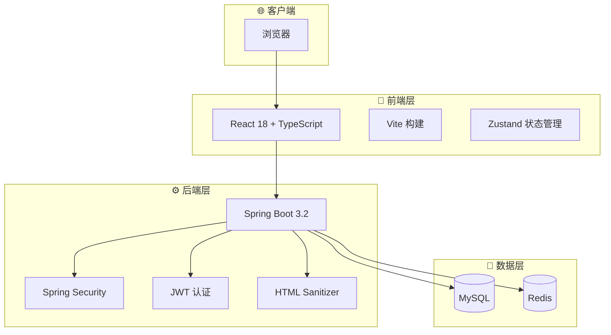
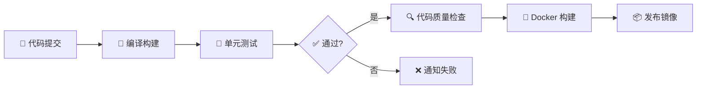

# 🚀 Blog System - Modern Full Stack Platform

<div align="center">


**一个经过深度安全审计与架构重构的现代化博客系统**

[快速开始](#-快速开始) • [技术架构](#-技术架构) • [安全特性](#-安全特性) • [API 文档](#-api-端点) • [部署指南](#-docker-部署)

</div>

---

## ✨ 项目亮点

| 亮点 | 说明 |
|------|------|
| 🔒 **安全加固** | XSS 防护、IDOR 漏洞修复、统一身份标识 |
| 🧪 **测试覆盖** | 完整的单元测试套件，覆盖核心业务逻辑 |
| 🔄 **CI/CD** | GitHub Actions 自动化构建、测试、部署 |
| 🐳 **容器化** | 多阶段 Docker 构建，生产级 Nginx 配置 |
| 📚 **文档完善** | Mermaid 架构图、技术总结、API 文档 |

---

## 🏗️ 技术架构



### 技术栈对比

| 层级 | 重构前 (Legacy) | 重构后 (Current) |
|------|----------------|------------------|
| **后端** | Node.js + Express | Spring Boot 3.2 |
| **模板** | EJS 服务端渲染 | React SPA |
| **认证** | Session Cookie | JWT + Spring Security |
| **安全** | ❌ 无 XSS 防护 | ✅ OWASP HTML Sanitizer |
| **测试** | ❌ 无测试 | ✅ JUnit 5 + Mockito |
| **CI/CD** | ❌ 手动部署 | ✅ GitHub Actions |
| **容器化** | ❌ 无 | ✅ Docker + Nginx |

---

## 🔒 安全特性

### 已解决的安全问题

| 问题 | 风险等级 | 解决方案 |
|------|---------|----------|
| XSS 注入 | 🔴 高 | OWASP HTML Sanitizer 消毒所有用户输入 |
| IDOR 越权访问 | 🔴 高 | 分层权限检查，Repository 强制过滤 |
| 身份标识混淆 | 🟡 中 | 统一使用 userId，引入 UserPrincipal |
| API 路由冲突 | 🟡 中 | 规范化 /api 前缀 |
| 环境变量泄露 | 🟡 中 | 移除硬编码密钥，使用环境变量 |

### 安全实现示例

```java
// XSS 防护：HTML 内容消毒
@Component
public class HtmlSanitizer {
    public String sanitizeBlogContent(String html) {
        return BLOG_POLICY.sanitize(html);  // 移除 script、iframe 等危险标签
    }
}

// 权限控制：可见性检查
if (!isAuthor && !isApprovedPublic && !isAdmin) {
    throw new UnauthorizedException("您无权查看此博客");
}
```

---

## 📂 项目结构

```
blog/
├── 📁 backend/                  # Spring Boot 后端
│   ├── src/main/java/com/blog/
│   │   ├── controller/          # REST API 控制器
│   │   ├── service/             # 业务逻辑层
│   │   ├── repository/          # 数据访问层
│   │   ├── entity/              # 数据模型
│   │   ├── dto/                 # 数据传输对象
│   │   ├── security/            # JWT + UserPrincipal
│   │   ├── util/                # HtmlSanitizer 工具类
│   │   └── exception/           # 全局异常处理
│   ├── src/test/java/           # 单元测试
│   └── Dockerfile               # 后端容器化配置
│
├── 📁 frontend/                 # React 前端
│   ├── src/
│   │   ├── api/                 # API 客户端
│   │   ├── components/          # 组件库
│   │   ├── pages/               # 页面组件
│   │   ├── store/               # Zustand 状态管理
│   │   └── types/               # TypeScript 类型
│   ├── Dockerfile               # 前端容器化配置
│   └── nginx.conf               # Nginx 配置
│
├── 📁 .github/workflows/        # CI/CD 流水线
│   ├── backend.yml              # 后端 CI/CD
│   └── frontend.yml             # 前端 CI/CD
│
├── 📁 docs/                     # 技术文档
│   └── 技术总结.md               # 深度审计报告
│
└── 📁 docker/                   # Docker Compose 配置
```

---

## 🚀 快速开始

### 前置条件

- Java 17+
- Node.js 20+
- MySQL 8.0+
- Redis 7+ (可选)

### 后端启动

```bash
cd backend

# 设置环境变量
export JWT_SECRET="your-secret-key-at-least-32-characters"
export DB_URL="jdbc:mysql://localhost:3306/blog?useUnicode=true&characterEncoding=UTF-8&serverTimezone=Asia/Shanghai&allowPublicKeyRetrieval=true&useSSL=false"
export DB_USERNAME="root"
export DB_PASSWORD="your-db-password"

# 运行
mvn spring-boot:run
```

### 前端启动

```bash
cd frontend
npm install
npm run dev
```

### 访问地址

| 服务 | 地址 |
|------|------|
| 前端 | http://localhost:5173 |
| 后端 API | http://localhost:8080 |
| Swagger 文档 | http://localhost:8080/swagger-ui.html |

---

## 🐳 Docker 部署

### 快速部署

```bash
# 构建镜像
docker-compose build

# 启动服务
docker-compose up -d
```

### docker-compose.yml

```yaml
version: '3.8'
services:
  frontend:
    build: ./frontend
    ports:
      - "80:80"
    depends_on:
      - backend
  
  backend:
    build: ./backend
    environment:
      - DB_URL=jdbc:mysql://mysql:3306/blog?useUnicode=true&characterEncoding=UTF-8&serverTimezone=Asia/Shanghai&allowPublicKeyRetrieval=true&useSSL=false
      - DB_USERNAME=root
      - DB_PASSWORD=${MYSQL_ROOT_PASSWORD}
      - JWT_SECRET=${JWT_SECRET}
    depends_on:
      - mysql
      - redis
  
  mysql:
    image: mysql:8.0
    environment:
      - MYSQL_DATABASE=blog
      - MYSQL_ROOT_PASSWORD=${MYSQL_ROOT_PASSWORD}
    volumes:
      - mysql_data:/var/lib/mysql
  
  redis:
    image: redis:7-alpine

volumes:
  mysql_data:
```

---

## 📡 API 端点

| 模块 | 端点 | 方法 | 说明 |
|------|------|------|------|
| **认证** | `/api/auth/register` | POST | 用户注册 |
| | `/api/auth/login` | POST | 用户登录 |
| | `/api/auth/refresh` | POST | 刷新令牌 |
| **博客** | `/api/blogs` | GET | 获取博客列表 |
| | `/api/blogs/{id}` | GET | 获取博客详情 |
| | `/api/blogs` | POST | 创建博客 🔐 |
| | `/api/blogs/{id}` | PUT | 更新博客 🔐 |
| | `/api/blogs/{id}` | DELETE | 删除博客 🔐 |
| **评论** | `/api/comments/blog/{blogId}` | GET | 获取博客评论 |
| | `/api/comments` | POST | 发表评论 🔐 |
| **用户** | `/api/users/{id}` | GET | 获取用户资料 |
| | `/api/users/profile` | PUT | 更新个人资料 🔐 |
| | `/api/users/{id}/follow` | POST | 关注用户 🔐 |

> 🔐 表示需要 JWT 认证

---

## 🧪 测试

### 运行单元测试

```bash
cd backend
mvn test
```

### 测试覆盖模块

- ✅ **BlogServiceTest** - 博客创建、可见性权限、XSS 消毒
- ✅ **AuthServiceTest** - 注册、登录、令牌刷新
- ✅ **CommentServiceTest** - 评论创建、删除权限、通知触发
- ✅ **UserServiceTest** - 资料管理、密码修改、关注系统
- ✅ **HtmlSanitizerTest** - XSS 攻击防护验证

---

## 📊 CI/CD 流水线



---

## 📚 相关文档

- [深度审计与系统重构技术总结](./docs/技术总结.md)
- [API 文档 (Swagger)](http://localhost:8080/swagger-ui.html)
- [快速开始指南](./docs/QUICK_START.md)

---

## 🤝 贡献指南

1. Fork 本仓库
2. 创建特性分支 (`git checkout -b feature/AmazingFeature`)
3. 提交更改 (`git commit -m 'Add some AmazingFeature'`)
4. 推送到分支 (`git push origin feature/AmazingFeature`)
5. 创建 Pull Request

---

## 📄 License

本项目采用 [ISC License](LICENSE) 开源协议。

---

<div align="center">

**⭐ 如果这个项目对你有帮助，请给个 Star！**

</div>
