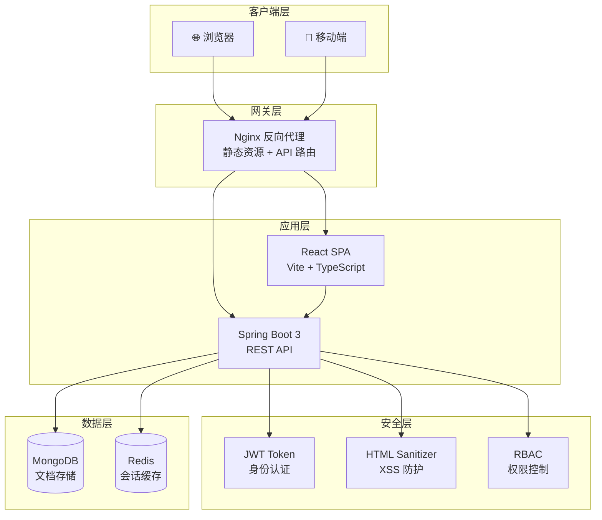
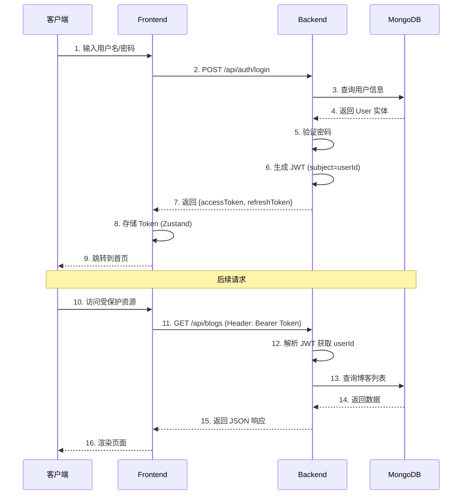
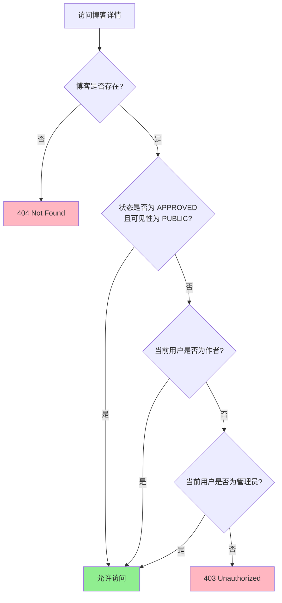
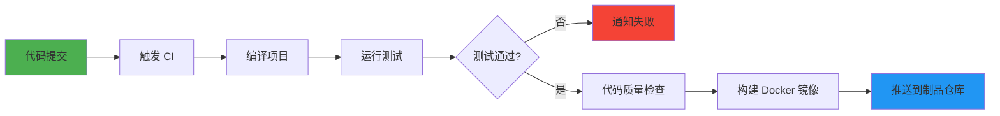

# 博客系统深度审计与系统重构技术总结

> **作者**: 项目负责人  
> **版本**: 2.0  
> **日期**: 2026-01

---

## 📋 项目概述

本项目是一个基于 **Spring Boot 3 + React** 的现代化博客系统，经过系统性的安全审计与架构重构，解决了原有系统中存在的身份标识混淆、XSS 安全漏洞、权限越界等关键问题。

### 技术栈

| 层级 | 技术选型 | 版本 |
|------|----------|------|
| 后端框架 | Spring Boot | 3.2.2 |
| 数据库 | MongoDB | 6.0 |
| 缓存 | Redis | 7.x |
| 安全框架 | Spring Security + JWT | 0.12.3 |
| 前端框架 | React + Vite | 18 + 5.x |
| 状态管理 | Zustand | 4.x |
| 容器化 | Docker + Nginx | Alpine |
| CI/CD | GitHub Actions | - |

---

## 🏗️ 系统架构图

### 整体架构



### 认证流程



### 权限控制流程



---

## 🔒 安全加固措施

### 1. 身份标识统一

**问题描述**：原系统使用 `username` 作为身份标识，导致多处逻辑混淆。

**解决方案**：

```java
// 新增 UserPrincipal 统一身份载体
public class UserPrincipal implements UserDetails {
    private final String id;        // MongoDB ObjectId
    private final String username;
    private final Boolean isAdmin;
    // ...
}

// JWT Token 使用 userId 作为 Subject
public String generateToken(String userId) {
    return Jwts.builder()
            .subject(userId)  // 使用用户ID而非用户名
            .claim("type", "access")
            .issuedAt(now)
            .expiration(expiration)
            .signWith(getSigningKey())
            .compact();
}
```

### 2. XSS 防护

**问题描述**：用户输入的 Markdown 内容直接存储，存在 XSS 注入风险。

**解决方案**：

```java
@Component
public class HtmlSanitizer {
    // 博客内容策略：允许常见格式标签
    private static final PolicyFactory BLOG_POLICY = new HtmlPolicyBuilder()
            .allowElements("h1", "h2", "h3", "p", "a", "img", "code", "pre")
            .allowUrlProtocols("http", "https")
            .disallowElements("script", "iframe", "object")
            .toFactory();
    
    // 评论策略：更严格
    private static final PolicyFactory COMMENT_POLICY = new HtmlPolicyBuilder()
            .allowElements("p", "br", "strong", "em")
            .toFactory();
}
```

### 3. 可见性权限控制

**问题描述**：未审核/私有博客可能被越权访问。

**解决方案**：

```java
// Repository 层强制状态过滤
Page<Blog> findByCategoryAndStatusAndVisibility(
    String category, 
    Blog.Status status,      // APPROVED
    Blog.Visibility visibility,  // PUBLIC
    Pageable pageable
);

// Service 层授权检查
if (!isAuthor && !isApprovedPublic && !isAdmin) {
    throw new UnauthorizedException("您无权查看此博客");
}
```

---

## 🧪 测试覆盖

### 单元测试矩阵

| 模块 | 测试类 | 测试用例数 | 覆盖场景 |
|------|--------|-----------|----------|
| 博客服务 | `BlogServiceTest` | 15+ | 创建、可见性权限、XSS消毒、更新删除 |
| 认证服务 | `AuthServiceTest` | 10+ | 注册、登录、令牌刷新 |
| 评论服务 | `CommentServiceTest` | 12+ | 创建、删除权限、通知触发 |
| 用户服务 | `UserServiceTest` | 10+ | 资料管理、密码修改、关注系统 |
| 安全工具 | `HtmlSanitizerTest` | 20+ | XSS 攻击防护验证 |

### 测试命令

```bash
# 运行所有单元测试
mvn test

# 生成覆盖率报告
mvn jacoco:report
```

---

## 🚀 CI/CD 流水线

### 工作流程



### GitHub Actions 配置

- **backend.yml**: 后端构建、单元测试、Docker 镜像打包
- **frontend.yml**: 前端构建、ESLint 检查、Docker 镜像打包

---

## 📊 重构前后对比

| 维度 | 重构前 | 重构后 |
|------|--------|--------|
| 身份标识 | ❌ username/userId 混用 | ✅ 统一使用 userId |
| XSS 防护 | ❌ 无 | ✅ OWASP HTML Sanitizer |
| 权限控制 | ❌ 可能越权访问 | ✅ 分层权限检查 |
| API 路由 | ❌ /api/api 双重嵌套 | ✅ 统一 /api 前缀 |
| 环境安全 | ❌ 硬编码密钥 | ✅ 环境变量管理 |
| 单元测试 | ❌ 0% | ✅ 核心业务覆盖 |
| CI/CD | ❌ 手动部署 | ✅ GitHub Actions 自动化 |
| 容器化 | ❌ 无 | ✅ 多阶段 Docker 构建 |

---

## 🎯 面试亮点

### 技术深度

1. **安全意识**：主动进行安全审计，发现并修复 XSS、IDOR 等漏洞
2. **架构设计**：统一身份标识、分层权限控制、API 规范化
3. **工程实践**：完善的单元测试、CI/CD 流水线、Docker 容器化

### 可展示能力

- 🔍 **问题发现能力**：通过代码审计发现隐藏的安全风险
- 🛠️ **解决问题能力**：系统性地设计并实施解决方案
- 📝 **文档能力**：清晰的技术文档和架构图
- 🔄 **持续改进**：建立自动化测试和部署流程

---

## 📚 相关文档

- [API 接口文档](/api-docs) - Swagger UI
- [部署指南](./DEPLOYMENT.md)
- [开发指南](./DEVELOPMENT.md)
