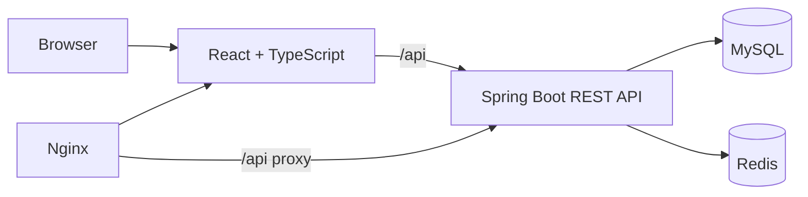

# 项目全量文档

## 项目概述

这是一个 Spring Boot + React 的前后端分离博客论坛平台。当前版本统一使用 MySQL + JPA 作为数据层，Redis 用于 Token 黑名单和限流，Docker Compose 用于本地和容器化运行。

## 功能模块

- 认证：注册、登录、刷新 Token、退出登录。
- 内容：文章发布、编辑、删除、Markdown 渲染、图片上传、审核、定时发布/下线。
- 互动：评论、回复、点赞、收藏、关注。
- 用户：个人资料、头像、密码修改、阅读历史。
- 通知/私信：评论、回复、提及、私信。
- 后台：文章审核、分类、标签、敏感词、举报、用户和操作日志。

## 架构说明



## 数据层

核心实体在 `backend/src/main/java/com/blog/entity/`：

- `User`：用户账号、密码、头像、简介、管理员/封禁状态。
- `Blog`：文章内容、状态、可见性、作者、分类、标签、阅读/点赞/收藏计数。
- `Comment`：文章评论、父评论和点赞。
- `Draft` / `DraftVersion`：草稿和版本。
- `Notification` / `Message`：通知和私信。
- `Category` / `Tag` / `Series`：内容组织。

## 启动与部署

本地启动详见 [QUICK_START.md](./QUICK_START.md)。容器化运行使用：

```bash
docker compose -f docker/docker-compose.dev.yml up --build
```

生产或服务器部署需要根据实际环境调整数据库密码、JWT 密钥、CORS、上传目录和域名。

## 测试与 CI

- 后端：`mvn test`。
- 前端：`npm run lint`、`npm run build`。
- GitHub Actions：后端编译测试、前端 lint/type/build、Docker 镜像构建校验。

## 面试资料

- [技术总结](./技术总结.md)
- [面试复盘](../INTERVIEW.md)
